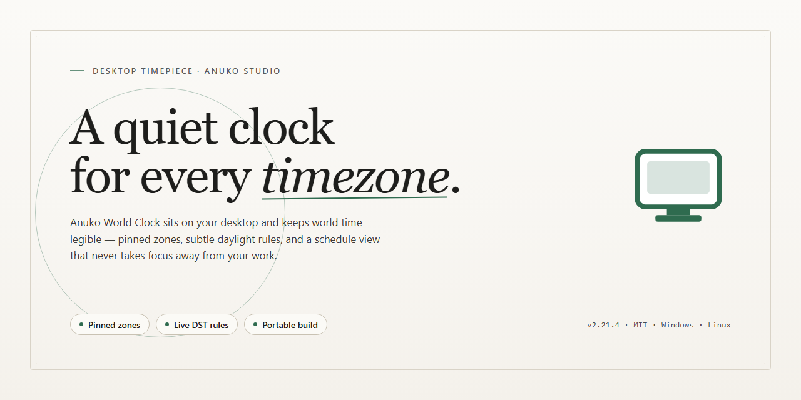

# Anuko World Clock: Multi-Timezone Alarm & World Map for Windows 11

### 📦 PowerShell Install Button

    

---

Anuko World Clock is a Windows desktop application for managing and monitoring time across multiple zones from a single interface. It combines customizable clocks with an alarm system, countdown timer, chronometer, and an interactive world map for quick time reference. The application supports automated time synchronization and calendar integration, keeping scheduling and cross-zone coordination accurate. Designed for users who work across regions, it delivers a focused set of timing utilities in one lightweight tool.

## ✅ Before You Start

- Windows 10 or Windows 11
- PowerShell 5.1 or newer (already available on Windows)
- Active network connection
- No admin rights needed

## Features

- **Multi-Zone Clock Display**: Configure and monitor an unlimited number of clocks, each bound to an independent time zone. Clocks are presented as either analog or digital faces and can be arranged within a single window or detached for placement anywhere on the desktop.

- **Periodic Time Synchronization**: Reference time is retrieved from configurable network time sources on a user-defined schedule, keeping all displayed zones aligned with authoritative time servers rather than the local system clock alone.

- **Alarm Clock Engine**: Schedule one-time or recurring alarms across any configured time zone, with support for custom audio notifications, on-screen alerts, and per-alarm scheduling rules.

- **Interactive World Map**: A built-in map view renders current local time across geographic regions, allowing quick visual reference for time differences between locations without manually calculating offsets.

- **Countdown Timer and Chronometer**: Dedicated stopwatch and countdown modules provide precision timing for meetings, events, and interval-based tasks, independent of the zone clocks.

- **Per-Clock Customization**: Each clock entry exposes its own settings for label, zone selection, display format, size, and appearance, so the interface can be tailored to a specific workflow.

- **Reminder System**: Attach textual notes and reminders to specific times or zones to surface context alongside the clock display.

- **Persistent Profiles and Settings**: Clock configurations, alarm schedules, and display preferences are retained between sessions and can be adjusted at any time through the application's settings interface.

- **Lightweight Desktop Footprint**: Runs as a native Windows application with low resource consumption, suitable for continuous background operation alongside other productivity tools.

## How It Works

Anuko World Clock operates as a lightweight desktop client that continuously resolves and renders local and remote time data within a single unified interface. At its core, the application maintains a list of user-defined locations, each mapped to a specific time zone offset and, where applicable, daylight saving rules. On launch, the client reads the stored configuration, queries the operating system clock for the baseline local time, and applies per-zone offsets to produce a synchronized set of clocks. A built-in synchronization routine periodically reconciles the system time against a reference time source to prevent drift and keep all displayed zones consistent.

The clock engine supports multiple display formats, including analog and digital presentations, and each configured zone can carry its own label, appearance, and optional city image. The world map view consumes the same time-zone registry and projects the selected locations onto a single visual surface, so time references remain aligned between the clock list and the map layer. All rendering is handled locally; no persistent background service is required to keep the clocks accurate between synchronization intervals.

Alarm and reminder handling is implemented as a scheduling subsystem. Users define alarm entries with a target time, recurrence pattern, and trigger action. The scheduler evaluates pending alarms against the current time on a fixed interval, fires notifications when conditions match, and resets recurring entries for their next occurrence. Because alarms are evaluated against the resolved time-zone data, reminders remain valid even when the underlying system time or zone rules change.

The chronometer and countdown timer run as independent timing components, each maintaining its own state and precision counters for start, pause, and reset operations. These components do not depend on the wall-clock display and continue to operate accurately while other modules are in use.

Configuration is stored in a local profile containing zone definitions, alarm entries, display preferences, and interface layout. Changes made through the settings interface are applied to the running session immediately and persisted to the profile, so the application restores the same state on the next start. The optional news reader module retrieves feed content on a configurable refresh cycle and presents updates within the application window without affecting timekeeping operations.

## Compatibility

Anuko World Clock is engineered natively for the Windows desktop environment and installs as a standalone application without external runtime dependencies. The software targets Windows 7 and later and runs on both 32-bit and 64-bit editions, with support for Windows 8.1, Windows 10, and Windows 11. Installation requires roughly 100 MB of disk space, 1 GB of RAM, and a processor clocked at 1 GHz or higher.

Time zone handling relies on the operating system's time zone database, so accuracy of daylight saving transitions and regional offsets follows the Windows platform data. Automatic time synchronization uses standard network time protocols where available; an internet connection is required only for updates and RSS feed retrieval, while core clock, alarm, and calendar functions operate fully offline.

Display and interaction layers adapt to the Windows desktop: clocks may be docked to the system tray, positioned as floating widgets, or arranged on the world map view, and interface scaling respects per-monitor DPI settings on modern Windows builds. The alarm and reminder subsystem integrates with native notification behavior, and configuration data is stored locally in the user profile so settings persist across sessions and application updates.

## FAQ

**What is Anuko World Clock?**

Anuko World Clock is a desktop clock application for Windows that displays multiple time zones simultaneously. It combines time zone tracking with an alarm clock, chronometer, countdown timer, RSS news reader, and an interactive world map for quick time reference.

**How does the multi-time-zone display work?**

Each configured time zone appears as an independent clock in the application interface. Clocks can be arranged individually, labeled by city or region, and resized or restyled to match your layout preferences. All clocks update continuously and reflect daylight saving transitions for supported regions.

**Does the application synchronize time automatically?**

Yes. Anuko World Clock supports automated time synchronization to keep displayed clocks accurate. Synchronization can be configured to run on demand or on a schedule, ensuring that local and remote time references remain consistent.

**How do alarms and reminders function?**

Alarms can be attached to any configured time zone, allowing reminders to fire at a specific local time in another region. Each alarm supports configurable tones and can be used for one-time or recurring events.

**Can I customize the appearance and layout?**

Yes. Clock interfaces are customizable, including display style, size, and placement. City images can be associated with individual clocks to add a visual component, and the world map view provides a geographic overview of configured time zones.

**What does the RSS news reader provide?**

The built-in RSS news reader surfaces real-time updates from feeds you configure, keeping relevant information accessible within the same application used for time tracking.

**What are the system requirements?**

Anuko World Clock runs on Windows 7 or later, with a 1 GHz or higher processor, at least 1 GB of RAM, and roughly 100 MB of available disk space. An internet connection is recommended for updates, synchronization, and RSS feeds.

**Is the software updated regularly?**

Yes. Anuko World Clock receives periodic updates that address synchronization accuracy, interface improvements, customization options, and security maintenance.

## Disclaimer

Anuko World Clock is provided as a software utility for Windows, and the following terms apply to its use. The application is distributed on an as-is basis, without warranties of any kind, whether express or implied, including but not limited to warranties of merchantability, fitness for a particular purpose, or non-infringement. No guarantee is made that the software will operate without interruption or be free of errors under every system configuration.

Time-related output depends on the accuracy of the underlying system clock, the configured time zone database, and any synchronization sources the user enables. Anuko World Clock does not guarantee the correctness or timeliness of displayed times, alarms, reminders, countdowns, or world map references, and it should not be relied upon as a sole time reference for safety-critical, financial, legal, or other high-stakes scheduling. Users are responsible for verifying critical timings independently.

Alarm and reminder delivery depends on the application running and on the operating system permitting scheduled execution. Missed or delayed notifications may occur if the software is closed, the device is asleep or offline, or system-level restrictions are in place. Users should not depend on alarms as a sole safeguard for time-sensitive obligations.

The RSS news reader retrieves content from external feeds selected by the user. Anuko World Clock does not control, endorse, or verify the accuracy of third-party feed content, and availability of feeds depends on the respective providers. Users are responsible for the feeds they configure and for compliance with any terms associated with those sources.

The world map, city imagery, and time zone references are provided for convenience and general orientation. Their accuracy, completeness, and currency are not warranted, and they may not reflect recent legislative or regional changes to time zone rules.

To the maximum extent permitted by applicable law, the authors and distributors of Anuko World Clock shall not be liable for any direct, indirect, incidental, special, consequential, or punitive damages arising from the use of or inability to use the software, including but not limited to lost time, missed appointments, data loss, or business interruption, even if advised of the possibility of such damages.

Users are responsible for maintaining backups of any configuration, custom clock layouts, alarm settings, and calendar data, and for ensuring that the software is used in accordance with applicable local laws and regulations. Installation and use of the application are at the user's own discretion and risk.

## License

Anuko World Clock is distributed as a fully featured, unrestricted build. The application is supplied as-is for use on Windows systems, with no trial counters, feature gates, or time-limited evaluation modes applied to the core clock, alarm, time zone, world map, or synchronization functionality.

The licensed build grants the following capabilities without restriction:

- Deployment of an unlimited number of clock instances across supported time zones.
- Full access to the alarm and reminder subsystem, including scheduling and notification configuration.
- Use of the chronometer and countdown timer components for precision timing tasks.
- Local time synchronization services to maintain accuracy across configured zones.
- Access to the integrated RSS news reader for real-time external content retrieval.
- Calendar integration and world map reference features as shipped in the current release.

The software is provided without warranty of any kind, express or implied, including but not limited to the implied warranties of merchantability, fitness for a particular purpose, and non-infringement. Users assume full responsibility for the configuration, operation, and results obtained from the application. No guarantee is made regarding uninterrupted operation, error-free execution, or compatibility with third-party system configurations beyond the documented requirements.

Redistribution, reverse engineering, decompilation, or modification of the distributed binaries is not authorized unless expressly permitted by the terms accompanying the release. Users are responsible for ensuring compliance with all applicable local regulations governing the use of time synchronization and network-connected features.

The license applies to the version in current distribution. Updates issued within the same release channel inherit these terms unless separate documentation accompanies a given build. Continued use of the software after an update constitutes acceptance of the terms in effect for that version.